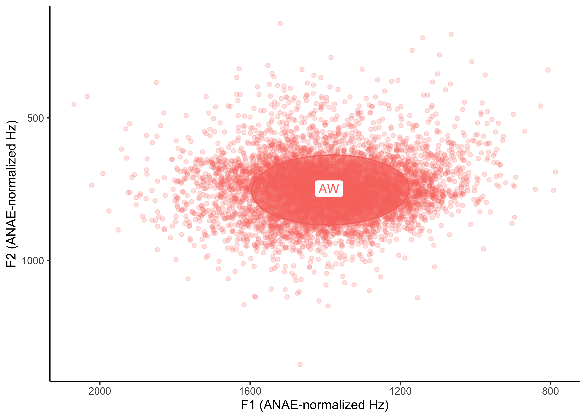
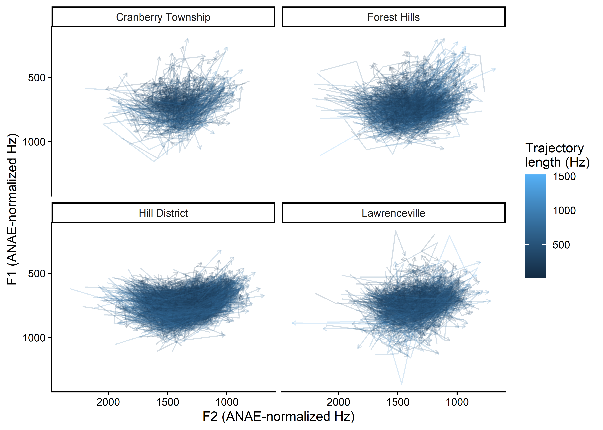
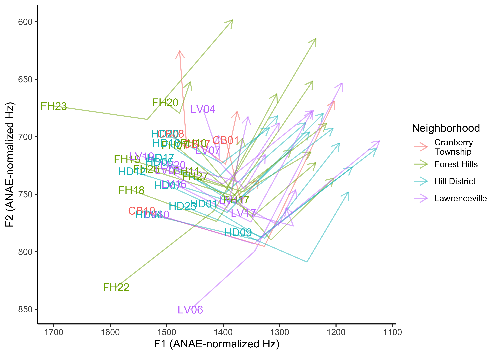
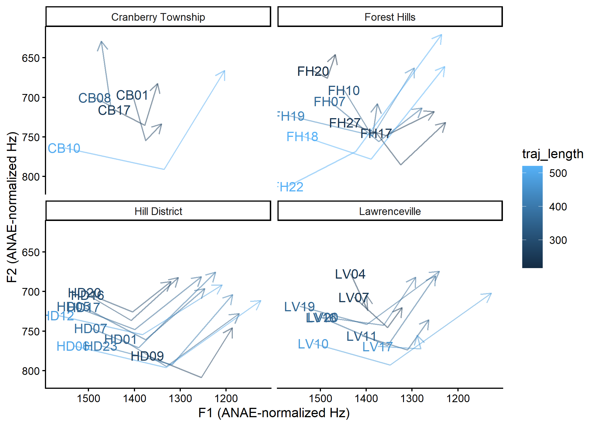

Intro to APLS Case Study
================
Jack Rechsteiner
2025-06-15, last updated 2026-02-09

- [Simple vowel case study](#simple-vowel-case-study)
- [Not used in article: Speaker
  trajectories](#not-used-in-article-speaker-trajectories)
- [Session Info](#session-info)

Note: This script uses the `joeyr` package for finding outliers, measure
euclidian distance, and ANAE normalization. However, `joeyr` is not
available on CRAN. To install `joeyr`:

    #install.packages("devtools") # <- if not already installed
    devtools::install_github("JoeyStanley/joeyr")

You can find more about `joeyr` at
<https://github.com/JoeyStanley/joeyr>.

## Simple vowel case study

We’ll start off with reading in the vowel data and taking a look to make
sure it loaded correctly.

While we’re at it, we’ll also create columns for the full Neighborhood
names and a column that reminds us what vowel we’re working with.

``` r
#reading in vowel data
vowel_data <- read.csv("csvs/results_processwithpraat.csv") |>
  mutate(
    #basing the values for the Neighborhood column on the neighborhood code in the speaker column
    Neighborhood = case_when(startsWith(Speaker, "CB") ~ "Cranberry Township",
                                  startsWith(Speaker, "FH") ~ "Forest Hills",
                                  startsWith(Speaker, "HD") ~ "Hill District",
                                  startsWith(Speaker, "LV") ~ "Lawrenceville",
                                  TRUE ~ "Interviewer"),
    #our results only included the "AW" vowel, so we can have "AW" be the value for every row of this column
    vowel = "AW")

vowel_data |> 
  head()
```

                                                    Title DataVersion
    1 APLS: the Archive of Pittsburgh Language and Speech       0.4.3
    2 APLS: the Archive of Pittsburgh Language and Speech       0.4.3
    3 APLS: the Archive of Pittsburgh Language and Speech       0.4.3
    4 APLS: the Archive of Pittsburgh Language and Speech       0.4.3
    5 APLS: the Archive of Pittsburgh Language and Speech       0.4.3
    6 APLS: the Archive of Pittsburgh Language and Speech       0.4.3
                                                 SearchName Number
    1 syllables=.*6[pbtdkgfvTDszSZhJ_mnNlrwjFHP]+ segment=6      1
    2 syllables=.*6[pbtdkgfvTDszSZhJ_mnNlrwjFHP]+ segment=6      2
    3 syllables=.*6[pbtdkgfvTDszSZhJ_mnNlrwjFHP]+ segment=6      3
    4 syllables=.*6[pbtdkgfvTDszSZhJ_mnNlrwjFHP]+ segment=6      4
    5 syllables=.*6[pbtdkgfvTDszSZhJ_mnNlrwjFHP]+ segment=6      5
    6 syllables=.*6[pbtdkgfvTDszSZhJ_mnNlrwjFHP]+ segment=6      6
              Transcript           Speaker    Line LineEnd
    1 CB01interview1.eaf Barbara Johnstone   4.359  12.529
    2 CB01interview1.eaf Barbara Johnstone  20.860  29.431
    3 CB01interview1.eaf Barbara Johnstone  20.860  29.431
    4 CB01interview1.eaf Barbara Johnstone  33.051  36.396
    5 CB01interview1.eaf Barbara Johnstone 238.681 239.999
    6 CB01interview1.eaf Barbara Johnstone 262.537 265.795
                                                                                                       MatchId
    1 g_352;em_12_107926;n_3092545-n_4584642;p_146;#=es_1_1766957;prefix=0001-;[0]=ew_0_685032;[1]=ew_0_685032
    2 g_352;em_12_107932;n_3092553-n_4584645;p_146;#=es_1_1767188;prefix=0002-;[0]=ew_0_685104;[1]=ew_0_685104
    3 g_352;em_12_107932;n_3092553-n_4584645;p_146;#=es_1_1767198;prefix=0003-;[0]=ew_0_685107;[1]=ew_0_685107
    4 g_352;em_12_107935;n_3092558-n_4584647;p_146;#=es_1_1767250;prefix=0004-;[0]=ew_0_685124;[1]=ew_0_685124
    5 g_352;em_12_108054;n_3092671-n_4584700;p_146;#=es_1_1767905;prefix=0005-;[0]=ew_0_685768;[1]=ew_0_685768
    6 g_352;em_12_108073;n_3092689-n_4584708;p_146;#=es_1_1768003;prefix=0006-;[0]=ew_0_685849;[1]=ew_0_685849
                                                                                     URL
    1 https://apls.pitt.edu/labbcat/transcript?transcript=CB01interview1.eaf#ew_0_685032
    2 https://apls.pitt.edu/labbcat/transcript?transcript=CB01interview1.eaf#ew_0_685104
    3 https://apls.pitt.edu/labbcat/transcript?transcript=CB01interview1.eaf#ew_0_685107
    4 https://apls.pitt.edu/labbcat/transcript?transcript=CB01interview1.eaf#ew_0_685124
    5 https://apls.pitt.edu/labbcat/transcript?transcript=CB01interview1.eaf#ew_0_685768
    6 https://apls.pitt.edu/labbcat/transcript?transcript=CB01interview1.eaf#ew_0_685849
      Before.Match       Text After.Match       word word.start word.end phonemes
    1           of background information background      6.019    6.269 b{kgr6nd
    2         some background        just background     26.870   27.290 b{kgr6nd
    3          for        our         own        our     27.730   27.830       6r
    4    Cranberry   Township         and   Township     34.331   34.841   t6nSIp
    5         what      about        your      about    239.211  239.331     @b6t
    6    Cranberry Township ?             Township ?    265.347  265.767   t6nSIp
      syllables syllables.start syllables.end orthography segment segment.start
    1    "gr6nd           6.109         6.269  background       6         6.169
    2    "gr6nd          27.070        27.290  background       6        27.160
    3       '6r          27.730        27.830         our       6        27.730
    4      't6n          34.331        34.561    township       6        34.411
    5      'b6t         239.241       239.331       about       6       239.271
    6      't6n         265.347       265.557    township       6       265.417
      segment.end time_0.2 F1.time_0.2 F2.time_0.2 time_0.5 F1.time_0.5 F2.time_0.5
    1       6.209    6.177         659        1408    6.189         754        1335
    2      27.220   27.172         690        1385   27.190         676        1519
    3      27.760   27.736         641        1331   27.745         625        1268
    4      34.481   34.425         378        1575   34.446         343        1567
    5     239.301  239.277         600        1513  239.286         624        1572
    6     265.517  265.437         386        1729  265.467         442        1621
      time_0.8 F1.time_0.8 F2.time_0.8 Error Neighborhood vowel
    1    6.201         405        1217    NA  Interviewer    AW
    2   27.208         574        1466    NA  Interviewer    AW
    3   27.754         603        1261    NA  Interviewer    AW
    4   34.467         357        1489    NA  Interviewer    AW
    5  239.295         618        1590    NA  Interviewer    AW
    6  265.497         420        1497    NA  Interviewer    AW

The data looks good, but there’s more columns here than we need. Let’s
just select the columns we’ll actually be working with.

``` r
vowel_data_smaller <- vowel_data %>%
  #selecting only necessary columns
  select(Speaker, Neighborhood, Text, syllables, starts_with("F"), MatchId, vowel)

#another quick look
vowel_data_smaller |> 
  head()
```

                Speaker Neighborhood       Text syllables F1.time_0.2 F2.time_0.2
    1 Barbara Johnstone  Interviewer background    "gr6nd         659        1408
    2 Barbara Johnstone  Interviewer background    "gr6nd         690        1385
    3 Barbara Johnstone  Interviewer        our       '6r         641        1331
    4 Barbara Johnstone  Interviewer   Township      't6n         378        1575
    5 Barbara Johnstone  Interviewer      about      'b6t         600        1513
    6 Barbara Johnstone  Interviewer Township ?      't6n         386        1729
      F1.time_0.5 F2.time_0.5 F1.time_0.8 F2.time_0.8
    1         754        1335         405        1217
    2         676        1519         574        1466
    3         625        1268         603        1261
    4         343        1567         357        1489
    5         624        1572         618        1590
    6         442        1621         420        1497
                                                                                                       MatchId
    1 g_352;em_12_107926;n_3092545-n_4584642;p_146;#=es_1_1766957;prefix=0001-;[0]=ew_0_685032;[1]=ew_0_685032
    2 g_352;em_12_107932;n_3092553-n_4584645;p_146;#=es_1_1767188;prefix=0002-;[0]=ew_0_685104;[1]=ew_0_685104
    3 g_352;em_12_107932;n_3092553-n_4584645;p_146;#=es_1_1767198;prefix=0003-;[0]=ew_0_685107;[1]=ew_0_685107
    4 g_352;em_12_107935;n_3092558-n_4584647;p_146;#=es_1_1767250;prefix=0004-;[0]=ew_0_685124;[1]=ew_0_685124
    5 g_352;em_12_108054;n_3092671-n_4584700;p_146;#=es_1_1767905;prefix=0005-;[0]=ew_0_685768;[1]=ew_0_685768
    6 g_352;em_12_108073;n_3092689-n_4584708;p_146;#=es_1_1768003;prefix=0006-;[0]=ew_0_685849;[1]=ew_0_685849
      vowel
    1    AW
    2    AW
    3    AW
    4    AW
    5    AW
    6    AW

Now we have a data frame that will be easier to manage in our workflow.

Next, let’s remove outliers, normalize measurements, and do some
subsetting on the data.

``` r
vowel_data_outliers_removed <-
  vowel_data_smaller %>%
  group_by(Speaker) %>%
  ##Drop speakers w/ fewer than 75 tokens for reliable outlier-checking
  filter(n() >= 75,
         #finding outliers based on all F1 and F2 measurements
         !find_outliers(F1.time_0.2, F2.time_0.2, F1.time_0.5, F2.time_0.5, F1.time_0.8, F2.time_0.8)) %>%
  ungroup()

#ANAE normalization
vowel_data_normed <-
  vowel_data_outliers_removed %>% 
  group_by(Speaker) %>% 
  joeyr_norm_anae(hz_cols = c(F1.time_0.2, F2.time_0.2, F1.time_0.5, F2.time_0.5, F1.time_0.8, F2.time_0.8), token_id = row.names(.), speaker_id = Speaker) %>%
  ungroup() 

#subsetting to remove incomplete words
vowel_data_subset <- 
  vowel_data_normed |>  
  filter(!str_detect(Text, "~$"))
```

The final steps we’ll do before making plots are calculating the
trajectory length of vowel tokens and pivoting the data to be longer.

We’ll also take another look at the data to see what shape it’s in
before plotting it.

``` r
vowel_data_longer <-
  vowel_data_subset |>
  #calculating trajectory length
  mutate(traj_length = eucl_dist(F2.time_0.2_anae, F2.time_0.5_anae, F1.time_0.2_anae, F1.time_0.5_anae) +
           eucl_dist(F2.time_0.5_anae, F2.time_0.8_anae, F1.time_0.5_anae, F1.time_0.8_anae)) |> 
  ##Longer for geom_paths
  pivot_longer(ends_with("_anae"), names_to=c(".value","timestamp"), names_pattern="(F[12]).time_(0\\.\\d)_anae") |>
  ##Remove unnormalized meas
  select(-contains("time_"))

vowel_data_longer |> 
  head()
```

    # A tibble: 6 × 10
      Speaker Neighborhood Text  syllables MatchId vowel traj_length timestamp    F1
      <chr>   <chr>        <chr> <chr>     <chr>   <chr>       <dbl> <chr>     <dbl>
    1 Barbar… Interviewer  back… "\"gr6nd" g_352;… AW           510. 0.2        688.
    2 Barbar… Interviewer  back… "\"gr6nd" g_352;… AW           510. 0.5        787.
    3 Barbar… Interviewer  back… "\"gr6nd" g_352;… AW           510. 0.8        423.
    4 Barbar… Interviewer  back… "\"gr6nd" g_352;… AW           261. 0.2        720.
    5 Barbar… Interviewer  back… "\"gr6nd" g_352;… AW           261. 0.5        706.
    6 Barbar… Interviewer  back… "\"gr6nd" g_352;… AW           261. 0.8        599.
    # ℹ 1 more variable: F2 <dbl>

The first plot is all the midpoints for all the vowels in the subset.

``` r
#plotting the vowel data
ggplot(vowel_data_subset, aes(x = F2.time_0.5_anae, y = F1.time_0.5_anae, color = vowel, label = vowel)) +
  #making slightly transparent points for each individual vowel
  geom_point(alpha = 0.2) +
  #making an ellipse for the vowel measurements overall
  stat_ellipse(level = .67, geom = "polygon", alpha = 0.6, aes(fill = vowel)) +
  #using the means data to add a label to the center
  geom_label(data = vowel_data_subset %>% 
               summarise(across(ends_with("0.5_anae"), mean),
                         across(vowel, unique))) +
  #flipping the scales, like a good vowel plot should
  scale_x_reverse("F1 (ANAE-normalized Hz)") + 
  scale_y_reverse("F2 (ANAE-normalized Hz)") +
  theme_classic() + 
  theme(legend.position="none")
```

<!-- -->

The second plot is the trajectories of all the subset vowels by
participant neighborhood, excluding tokens from interviewers.

``` r
vowel_data_longer |>
  filter(Neighborhood != "Interviewer") |>
  arrange(desc(traj_length)) |>
  ggplot(aes(x = F2, y = F1, color=traj_length)) +
  #making slightly transparent points for each individual vowel
  geom_path(aes(group=MatchId), alpha=0.2, arrow=arrow(length=unit(0.05, "inches"))) +
  facet_wrap(~ Neighborhood) +
  #flipping the scales, like a good vowel plot should
  scale_x_reverse("F1 (ANAE-normalized Hz)") + 
  scale_y_reverse("F2 (ANAE-normalized Hz)") +
  labs(color="Trajectory\nlength (Hz)") +
  theme_classic()
```

<!-- -->

## Not used in article: Speaker trajectories

It seems like there are some neighborhood-level differences in vowel
productions, and we can investigate this further by looking at the
average trajectories by speaker.

Note: These plots are not included in *Introducing the Archive of
Pittsburgh Language and Speech (APLS), a publicly accessible, richly
annotated corpus of sociolinguistic interviews* but are included here as
they may be of interest to other researchers.

``` r
vowel_data_means <- 
  vowel_data_longer |>
  summarise(across(Neighborhood, unique),
            across(c(F1, F2, traj_length), mean),
            .by=c(Speaker, timestamp)) |>
  ##Break Cranberry Township across two lines
  mutate(across(Neighborhood, \(x) if_else(x=="Cranberry Township", "Cranberry\nTownship", x)))

vowel_data_means |>
  filter(Neighborhood != "Interviewer") |>
  ggplot(aes(x = F2, y = F1, color=Neighborhood)) +
  geom_path(aes(group=Speaker), alpha=0.5, arrow=arrow(length=unit(0.125, "inches"))) +
  geom_text(data=vowel_data_means |> 
              filter(Neighborhood != "Interviewer",
                     timestamp==0.2),
            aes(label = Speaker), show.legend=FALSE) +
  #flipping the scales, like a good vowel plot should
  scale_x_reverse("F1 (ANAE-normalized Hz)") + 
  scale_y_reverse("F2 (ANAE-normalized Hz)") +
  theme_classic()
```

<!-- -->

This is nice, but it’s still a little messy and it isn’t capturing any
information about participant’s average trajectory lengths.

Instead, let’s use color to indicate trajectory length and facet the
plots by neighborhood to make the differences easier to see.

``` r
vowel_data_means |>
  filter(Neighborhood != "Interviewer") |>
  #changing Cranberry Township back to a space instead of a newline break
  mutate(across(Neighborhood, \(x) if_else(x=="Cranberry\nTownship", "Cranberry Township", x))) |> 
  ggplot(aes(x = F2, y = F1, color=traj_length)) +
  geom_path(aes(group=Speaker), alpha=0.5,arrow=arrow(length=unit(0.125, "inches"))) +
  geom_text(data=vowel_data_means |>
              #changing Cranberry Township back to a space instead of a newline break
              mutate(across(Neighborhood, \(x) if_else(x=="Cranberry\nTownship", "Cranberry Township", x))) |> 
              filter(Neighborhood != "Interviewer",
                     timestamp==0.2),
            aes(label = Speaker), show.legend=FALSE) +
  facet_wrap(~ Neighborhood) +
  #flipping the scales, like a good vowel plot should
  scale_x_reverse("F1 (ANAE-normalized Hz)") + 
  scale_y_reverse("F2 (ANAE-normalized Hz)") +
  theme_classic()
```

<!-- -->

# Session Info

``` r
sessionInfo()
```

    R version 4.3.2 (2023-10-31)
    Platform: x86_64-apple-darwin20 (64-bit)
    Running under: macOS 15.3.1

    Matrix products: default
    BLAS:   /Library/Frameworks/R.framework/Versions/4.3-x86_64/Resources/lib/libRblas.0.dylib 
    LAPACK: /Library/Frameworks/R.framework/Versions/4.3-x86_64/Resources/lib/libRlapack.dylib;  LAPACK version 3.11.0

    locale:
    [1] en_US.UTF-8/en_US.UTF-8/en_US.UTF-8/C/en_US.UTF-8/en_US.UTF-8

    time zone: America/Detroit
    tzcode source: internal

    attached base packages:
    [1] stats     graphics  grDevices utils     datasets  methods   base     

    other attached packages:
     [1] joeyr_0.11      tidynorm_0.3.0  lubridate_1.9.4 forcats_1.0.0  
     [5] stringr_1.5.1   dplyr_1.1.4     purrr_1.1.0     readr_2.1.5    
     [9] tidyr_1.3.1     tibble_3.3.0    ggplot2_3.5.2   tidyverse_2.0.0

    loaded via a namespace (and not attached):
     [1] gtable_0.3.6       compiler_4.3.2     Rcpp_1.1.0         tidyselect_1.2.1  
     [5] scales_1.4.0       yaml_2.3.10        fastmap_1.2.0      R6_2.6.1          
     [9] labeling_0.4.3     generics_0.1.4     knitr_1.50         MASS_7.3-60.0.1   
    [13] pillar_1.11.0      RColorBrewer_1.1-3 tzdb_0.5.0         rlang_1.1.6       
    [17] utf8_1.2.6         stringi_1.8.7      xfun_0.52          timechange_0.3.0  
    [21] cli_3.6.5          withr_3.0.2        magrittr_2.0.3     digest_0.6.37     
    [25] grid_4.3.2         rstudioapi_0.17.1  hms_1.1.3          lifecycle_1.0.4   
    [29] vctrs_0.6.5        evaluate_1.0.4     glue_1.8.0         farver_2.1.2      
    [33] rmarkdown_2.29     tools_4.3.2        pkgconfig_2.0.3    htmltools_0.5.8.1 
